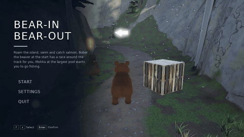

# Bear-In Bear-Out
[](https://github.com/msmiech/bibo/actions/workflows/build.yml)

Bear-In Bear-Out (BIBO) is a simple 3D game in which the objective is to complete a lap as fast as possible, avoid the hedgehogs on the way and catch salmon for bonus points



The GIF is recorded by the [README GIF workflow](.github/workflows/readme-gif.yml) when a pull request is opened:
the game plays the input of [tools/readme_demo.txt](tools/readme_demo.txt) (`BIBO --demo <script> --record <file>`)
and [tools/record_gameplay.sh](tools/record_gameplay.sh) converts the frames with FFmpeg.

## Features
* The race track is a path through a snowy forest on an island (see [The world](#the-world) below)
  * Voxel terrain: the track terrain in the middle, forest hills and mountains around it, beaches and cliffs down to the sea, caves over parts of the track
  * Spruces and pines on the slopes left and right of the track, bushes, junipers, ferns, grass, mushrooms (glowing ones in the caves), stones, fallen logs and stumps, all generated by the game
  * World partitioning, streaming and level of detail: the island is split into chunks that worker threads mesh in the level of detail their distance needs, the vegetation is drawn instanced with levels of detail and fades out in the distance; the physics world only contains the terrain and the trees around the bear
  * Physically based materials (generated when the game starts): forest floor, the dirt trail, granite, snow, sand, bark, needles and leaves
  * A bright polar day: low sun, clouds and polar lights (aurora) in the sky, cascaded shadow maps, fog, falling snow and simple water
* Animals on the track (see [The animals](#the-animals) below)
  * Large hedgehogs stroll around on the track, rendered like the bear (banded spines and fur as strands, the same eyes and skin): they walk with little steps, stop to sniff around and walk on. Running into one knocks the bear over (ouch, the spines) and its spines stand up
  * Salmon jump out of the pools of water on the track when the bear comes close. The bear can catch one per pool (e.g. when it jumps over the water) for 100 bonus points:
    it carries the fish in its mouth and as soon as it is on the ground it sits down, holds it in its front paws, takes three big bites, chews happily with closed eyes and licks its lips
* Music: a cheerful, looping calypso with steel drum, whistle, marimba, bass, percussion and slapstick effects, synthesized by the game (see [The music](#the-music) below)
* The player character is a young brown bear (see [The bear](#the-bear) below)
  * Skeleton with inverse kinematics: procedural walking and bounding with the paws planted on the terrain, the body follows slopes and leans into turns
  * Strand based fur that is generated on the GPU and reacts to movement, wind, the ground, obstacles and hits
  * Detailed face: eyes with iris and pupil that look around and blink with their eyelids, a jaw, tongue and teeth, ears and tail that swing
  * Running into a hedgehog knocks the bear over: it tumbles as a ragdoll until it lies still, then gets up, shakes its fur and runs on
  * Idle animations when it stands still for a while: it sits down and stretches (and sticks its tongue out), or sits down and yawns
  * Jumps in a natural arc: holding the button jumps higher, it can still jump right after running over an edge and a jump pressed shortly before landing happens on landing; in the air the bear keeps its momentum
  * Jump animation: the hind legs push off, the legs tuck in, before landing they reach for the ground and the landing is absorbed (the harder, the deeper)
* Third person camera
  * Orbits around the bear with the mouse or the right stick, the mouse wheel zooms, it goes back behind the running bear on its own
  * Does not go into the terrain or through the trees (sphere cast into the physics world)
  * Unlocked mode (L) = 3d flying camera (WASD and the mouse)
* Movable objects with physics (based on Jolt Physics, originally Nvidia PhysX)
* Texture Mapping (including normal maps)
* Lighting and Materials
* A lap around the track: the finish line only counts after all checkpoints along the track were passed in order
* Keyboard and mouse controls
  * WASD or arrow keys to run (relative to the camera)
  * Mouse to look around, mouse wheel to zoom, middle mouse button to put the camera behind the bear
  * Space bar to jump (hold to jump higher)
  * R to restart
  * ESC for the pause menu
  * F-Keys for settings and debug features (F1 for help)
* Gamepad controls (e.g. Sony DualSense, Xbox Series controller)
  * Left stick to run, right stick to look around (press it to put the camera behind the bear)
  * Cross / A to jump (hold to jump higher)
  * Options / Start for the pause menu, D-pad, Cross / A and Circle / B in the menus
  * Other controllers work if GLFW knows them; newer mappings can be added in a `gamecontrollerdb.txt` ([SDL_GameControllerDB](https://github.com/mdqinc/SDL_GameControllerDB)) in the game folder
* Settings for the camera sensitivity and inverting the camera up/down, and for the music (on or off)
* Main menu, pause menu, game over menu (restart the run or back to the main menu) and settings menu (based on RmlUi, usable with mouse, keyboard or gamepad)
  * Graphics settings (VSync, HDR, bloom, shadows, normal mapping, transparency, texture filtering, mipmapping, wireframe)
  * Resolution and window mode (windowed, fullscreen or borderless)
* Supports complex models (Collada scenes and skinned glTF models)
* HDR with auto exposure (the eyes adapt in the caves) and ACES tone mapping
* Bloom
* Animations (procedural skeletal animation of the bear, animated objects, vegetation swaying in the wind)
* Transparency
* Cascaded shadow maps
* View frustum culling: objects and chunks outside of the camera's view are not drawn (F8 to switch it off, the HUD shows how many objects, chunks and plants are drawn)
* Settings for the detail of the world (how far the levels of detail and the vegetation reach)

## Building
The game is built with [CMake](https://cmake.org) 3.25 or newer, the [Ninja](https://ninja-build.org) build tool and any C++17 compiler (Clang, GCC, MinGW-w64 or MSVC).
All libraries are downloaded and built automatically the first time the project is configured (about 180 MB, internet access required),
so apart from the tools only the OpenGL and windowing headers of the operating system are needed.
Running the game requires a graphics card with OpenGL 4.3 support.

### Windows
1. **Install the tools (once).** The recommended compiler is [LLVM-MinGW](https://github.com/mstorsjo/llvm-mingw) (Clang/LLVM with the Universal C Runtime of Windows).
   It does not need Visual Studio or the Windows SDK, and the game it builds runs without any extra DLLs.
   In PowerShell:

   ```powershell
   winget install --id Kitware.CMake -e
   winget install --id MartinStorsjo.LLVM-MinGW.UCRT -e
   winget install --id Ninja-build.Ninja -e
   ```

   Without winget, download the `llvm-mingw-<version>-ucrt-x86_64.zip` from the [LLVM-MinGW releases](https://github.com/mstorsjo/llvm-mingw/releases)
   and `ninja-win.zip` from the [Ninja releases](https://github.com/ninja-build/ninja/releases), unpack them and add their folders (for LLVM-MinGW the `bin` folder) to the `Path` environment variable.

2. **Open a new terminal** (changes to `Path` only apply to newly started terminals) and check that all tools are found:

   ```powershell
   cmake --version
   ninja --version
   clang --version
   ```

3. **Configure and build** in the folder of this repository:

   ```powershell
   cmake -S . -B build -G Ninja -DCMAKE_BUILD_TYPE=Release
   cmake --build build --parallel
   ```

   `-G Ninja` is required on Windows: without it CMake looks for Visual Studio or Microsoft's NMake.

4. **Run the game:**

   ```powershell
   cd build
   .\BIBO.exe 1280 720 0
   ```

Alternatively, [MSYS2](https://www.msys2.org) provides GCC: install the packages `mingw-w64-ucrt-x86_64-toolchain mingw-w64-ucrt-x86_64-cmake mingw-w64-ucrt-x86_64-ninja` with `pacman`
and run steps 3 and 4 in the *MSYS2 UCRT64* shell (`./BIBO.exe 1280 720 0`).
Visual Studio 2022 or newer can also open the folder directly as a CMake project.

### Linux
1. **Install the tools and headers (once).** On Debian/Ubuntu:

   ```bash
   sudo apt install build-essential cmake ninja-build git pkg-config libgl-dev libx11-dev libxrandr-dev libxinerama-dev libxcursor-dev libxi-dev libwayland-dev libxkbcommon-dev wayland-protocols
   ```

2. **Configure and build** in the folder of this repository:

   ```bash
   cmake -S . -B build -G Ninja -DCMAKE_BUILD_TYPE=Release
   cmake --build build --parallel
   ```

3. **Run the game:**

   ```bash
   cd build
   ./BIBO 1280 720 0
   ```

To use the libraries of the distribution instead of downloading them, also install `libglfw3-dev libglm-dev libassimp-dev libfreetype-dev libglew-dev` and add `-DBIBO_USE_SYSTEM_LIBS=ON` to the configure command.

### macOS
Not supported: the game requires OpenGL 4.3, macOS only provides OpenGL 4.1.

### Running and distributing
The build copies the game assets (`Font`, `Shader`, `Texture`, `UI`, the scene `Model/SnowTerrain/track1.dae` and the bear `Model/BearCub/BearCub.glb`) next to the executable, and the game loads them from the current folder, so always start it from the build folder.
The game starts in the main menu, ESC opens the pause menu during the game.
While it loads, the game generates the island (about a second with a few processor cores); with a software renderer (e.g. Mesa's llvmpipe) the world is drawn with less detail.
The settings menu saves the settings to `settings.cfg` in the current folder (a text file, delete it to reset the settings).
The command line arguments `BIBO [width height [fullscreen]]` override the saved resolution and window mode: width and height of the window in pixels and `1` for fullscreen (default: `800 600 0`).

To play a scripted run (e.g. [tools/readme_demo.txt](tools/readme_demo.txt), see `BIBO/Util/DemoScript.hpp` for the commands), add `--demo <script>`; `--record <file>` writes every frame to a file as raw RGB video.
With either option the game runs with a fixed time step (`--fps <frames per second>`, default 15) and the default settings, so a script always plays the same way.
[tools/record_gameplay.sh](tools/record_gameplay.sh) records the GIF at the top of this page (FFmpeg required; on a server without a display run it with `xvfb-run`):

```bash
tools/record_gameplay.sh build
```

To create a folder with the executable and all assets that can be copied to another computer:

```bash
cmake --install build --prefix BIBO-dist
```

Ready-to-run packages for Windows and Linux are attached to the [releases](https://github.com/msmiech/bibo/releases).
They are built by the [release workflow](.github/workflows/release.yml) when a version tag is pushed, e.g. for version 2.0:

```bash
git tag 2.0
git push origin 2.0
```

Tags with a suffix such as `2.1-rc1` are published as pre-releases.

For a debug build (OpenGL debug output on the console) configure a separate folder with `-DCMAKE_BUILD_TYPE=Debug`, e.g. `cmake -S . -B build-debug -G Ninja -DCMAKE_BUILD_TYPE=Debug`.

### Troubleshooting
* `Running 'nmake' '-?' failed` or `CMAKE_CXX_COMPILER not set`: CMake did not find Ninja or a compiler.
  Check step 2, then configure again with `-G Ninja` and `--fresh` (a failed configuration is remembered in the `build` folder):
  `cmake --fresh -S . -B build -G Ninja -DCMAKE_BUILD_TYPE=Release`
* To use a specific compiler, add e.g. `-DCMAKE_C_COMPILER=clang -DCMAKE_CXX_COMPILER=clang++` to the configure command (together with `--fresh`).
* `Could not create a window with an OpenGL 4.3 core context`: update the graphics driver; OpenGL 4.3 is required.

## Testing
The automated tests use [Catch2](https://github.com/catchorg/Catch2) and are built together with the game (configure with `-DBIBO_BUILD_TESTS=OFF` to skip them).
Run them in the build folder with CTest:

```bash
ctest --test-dir build --output-on-failure
```

The tests are in the `tests` folder:
* `unit`: game rules (falling off the track, checkpoints in their order, the finish line), physics (gravity, ground, walls, the bear walking, climbing, sliding and jumping, rock collisions, a moving hedgehog touching the bear, ray casts, sphere casts, ragdolls falling and coming to rest with connected joints), animation (transforms, forward kinematics, two bone IK, springs), the fur (guide hairs lag behind, hang down, lie on the ground and on obstacles, hits ruffle them; strand placement), the view frustum (compared with the camera matrices for random cameras), math helpers, the generated textures, the input (stick dead zones, moving relative to the camera), the noise of the world, the worker threads, the shadow cascades (they cover their slice of the view and move in whole texels), the includes of the shader files, the animals (hedgehogs stroll around their home and stay on the ground they can walk on, salmon jump only near the bear, high enough to be caught, one per pool; the generated models) and the music (the notation of the melodies, a loud enough loop without a click where it starts again, the same every time)
* `assets`: the content of the asset files, e.g. every node the game loads exists in the track, the bear starts on the terrain and on the finish line, going backwards from the start does not count, the checkpoints are apart; the world (the height field of the track matches its mesh, the path goes around the lap through the checkpoints on the floor of the canyon, the ground on the track is the track terrain, the island is surrounded by sea with beaches and cliffs, the caves leave room for the bear to run and jump, the pools of water on the track are deep enough for salmon, the hedgehogs stay on the floor of the track, neighboring chunks fit together without cracks, the levels of detail, trees grow next to the track but not on it, the streaming of the chunks, the vegetation and the physics); the bear model (its skeleton matches its skinning, it stands on the ground and fits its capsule, fur and bare skin, eyes, mouth, tongue, teeth and claws) and the bear in action (paws planted while it runs, knocked down by a rock it tumbles, gets up and runs again, rolling over from its back, idle animations and how moving interrupts them, carrying and eating a caught fish (and dropping it when it is knocked down), blinking and looking around, steering, jumping higher the longer the button is held, jumping after running over an edge and just before landing, the legs reaching for the ground and landing without jumping paws)
* `gl`: everything that needs an OpenGL 4.3 context: shaders, textures, models and their bounding spheres, the generated materials and the sky, the camera (orbiting, following, going back behind the bear, keeping out of obstacles) and the whole scene (a frame of the renderer, culling never removes a visible pixel and leaves out the chunks and plants that are not in view, the camera never goes into the terrain of the track). These tests are reported as *skipped* if no context can be created (no display, no OpenGL 4.3).
  On Linux servers without a graphics card they run on a virtual X server with Mesa's software renderer: `xvfb-run -a ctest --test-dir build --output-on-failure`

Every test case is a separate CTest test and its Catch2 tags become CTest labels, e.g. only the physics tests: `ctest --test-dir build -L physics`.
The test executable can also be run directly, e.g. `build/tests/bibo_tests "[rules]"` (see `--help` for the options of Catch2).

The CI also runs the tests with AddressSanitizer and UndefinedBehaviorSanitizer (memory errors, leaks, undefined behavior). On Linux:

```bash
CFLAGS="-fsanitize=address,undefined" CXXFLAGS="-fsanitize=address,undefined" LDFLAGS="-fsanitize=address,undefined" cmake -S . -B build-asan -G Ninja -DCMAKE_BUILD_TYPE=RelWithDebInfo
cmake --build build-asan --parallel
UBSAN_OPTIONS=halt_on_error=1 xvfb-run -a ctest --test-dir build-asan --output-on-failure
```

## Implementation Details
### Language and Compiler
This project was originally written in C++11 using Microsoft Visual Studio 2013.
It now uses C++17 and CMake, and builds with GCC, Clang, MinGW-w64 and MSVC on Windows and Linux.
For hardware graphics (modern) OpenGL 4.3 (core profile) is used.
It was developed for Windows 8.1 and Windows 10 and tested using Nvidia GeForce graphics hardware
### The world
The island is generated when the game starts (`BIBO/World`), nothing of it is stored in files, and it is the same every time.

**Voxel terrain** (`WorldGenerator`): the ground is a signed density field, positive in the ground and negative in the air, so it can have overhangs and caves.
In the middle it is the terrain of the track (the node `Boden` of the track file, rasterized into a height field, `TrackTerrain`), so the track stays exactly as it was.
Outside of it the terrain goes on as its blurred border and turns into procedural forest hills (gradient noise, ridges and a few mountains) that go down to the coast:
beaches with a gentle slope into the sea and cliffs (with 3D noise for overhangs), alternating along the coast. The water of the track is the sea level.
The center line of the track (`TrackPath`) is found in the terrain: the cheapest way along the floor of the canyon through the checkpoints (Dijkstra), smoothed and moved into the middle of the floor.
Two stretches of the track where the walls are high get a rock roof (caves), the objects of the track (signs, the finish line) are kept free.

**Chunks and levels of detail** (`Chunk`, `ChunkMesher`): the world is split into cubes of 32 units. Each one is meshed with Surface Nets (a vertex per voxel that the surface goes through, moved onto the surface, a quad per crossed voxel edge)
in one of four levels of detail: 32, 16, 8 or 4 voxels per side, depending on its distance from the camera. Neighbors with the same level fit together exactly; skirts along the border of a chunk hide the cracks to neighbors with another level.
Every vertex knows what the ground is (trail, sand, bare rock, snow) and how much of the sky it sees (ambient occlusion, dark in the caves).

**Streaming** (`WorldStreamer`, `WorkerPool`): worker threads mesh the chunks and scatter the vegetation, the closest and most needed first; the game uploads the results while it runs.
Around the bear the chunks are in full detail and in the physics world (collision meshes built by the worker threads), together with the trunks of the trees and the boulders; further away they are removed again.
Grass, ferns, mushrooms and pebbles are only placed close to the camera.

**Vegetation** (`Vegetation`, `VegetationMeshes`, `VegetationRenderer`): spruces (built from drooping, serrated branches), pines, bushes, junipers, ferns, grass, mushrooms, stones, logs and stumps are generated meshes with up to three levels of detail.
They are scattered on jittered grids per column of the world with rules (trees on the slopes next to the track and in the forest, never on the floor of the track, nothing in the sea, glowing mushrooms along the walls of the caves).
Every frame the visible instances are sorted by model and level of detail and drawn with one instanced draw call each; they sway in the wind and shrink to nothing before they are left out in the distance.

**Rendering** (`BIBO/Render`, `Shader`): physically based shading (GGX) with the sun, the sky as environment light and cascaded shadow maps (4 cascades).
The materials (`MaterialTextures`, `Shader/material_generator.frag`) are generated on the graphics card: color, roughness, normal map, height and occlusion of each, projected onto the terrain from three axes and blended by their height.
The sky (`SkyRenderer`) is a cube map, one face of it is rendered again every frame: the gradient of a bright polar day, the glow of the low sun, clouds and polar lights (curtains with rays, followed through their height).
The scene is rendered in HDR, then bloom, auto exposure and ACES tone mapping. Water and falling snow (generated from the instance number, no data per flake, none in the caves) are drawn last.

### The bear
**Model.** `Model/BearCub/BearCub.glb` is generated by a Blender script, so it can be changed and rebuilt (Blender 4.2 or newer, tested with 5.2):

```bash
blender --background --factory-startup --python tools/build_bear_cub.py
```

The body is a signed distance field of soft-blended primitives (see `PRIMITIVES` in the script) with the mouth carved out of it;
its surface is extracted and remeshed into evenly sized quads. Eyes, eyelids, nose, tongue, teeth and claws are separate meshes.
The skeleton has a spine chain, a head with jaw, tongue, eyes, eyelids and ears, legs with two IK bones each plus a paw, and a tail;
the skin weights come from Blender's automatic weights (the jaw's from its shape). The mouth is modelled open, the game closes it with the jaw.
The vertex colors hold the fur color and the fur length (alpha), the eyes the direction from their center (iris and pupil are drawn by the shader).
The script also saves `Model/BearCub/BearCub.blend` to look at the result, and `--preview <folder>` renders preview images.

**Animation** (`BIBO/Scene/BearRig.cpp`, `BIBO/Animation`): there are no animation clips, the pose is computed every frame.
When walking and bounding, the paws are planted where they land (found with ray casts) and the legs reach them with two bone inverse kinematics;
the body bobs with the steps, follows the ground and leans into turns. Ears and tail are springs, the eyes make saccades and blink with their lids.
The idle animations (stretching, yawning) and getting up are key poses of the body, the paws and the face, also solved with IK.
In a jump the hind paws push off from where they left the ground, the legs tuck in, and when a ray cast finds that the ground is close (by the falling speed)
the legs reach for it; on landing the paws are put down where they are, springs dip the body and the nose and the steps blend in.

**Fur** (`BIBO/Scene/Fur.cpp`, `Shader/bear_fur.*`): every vertex of the skin has a guide hair, a damped spring that lags behind when the body
accelerates, hangs down, moves in the wind, lies on the ground and on the spines of the hedgehogs and is ruffled by hits (simulated on the CPU).
60000 strands are generated on the GPU from the skinned vertices (no vertex buffer, only the triangle and the position on it per strand):
each strand is a curved, camera facing ribbon that interpolates the guide hairs of its triangle, shaded with Kajiya-Kay highlights.
Further away fewer, wider strands are drawn.

**Ragdoll** (`BIBO/Scene/BearCharacter.cpp`): running into a hedgehog starts a Jolt ragdoll (capsules with swing-twist and hinge joints) from the current pose and
velocities. When it lies still, the bear rolls over if it is on its back, pushes itself up, shakes its fur and gets back the control.
### The animals
**Hedgehogs** (`BIBO/Scene/Hedgehog.cpp`): twelve hedgehogs live where the rocks of the track are (the nodes `Rock1` to `Rock12`).
Each one strolls around its home: it walks to a random spot nearby on the floor of the track (not too close to the walls, never into the water), sniffs around for a while and walks on.
It turns while it walks, its feet trot in diagonal pairs, the body bobs and waddles, and when the bear runs into it, it hops up in surprise.
Its collision sphere is a kinematic body in the physics world that the game moves with it, so it knocks the bear over like the rocks did, also when it walks into the bear.

**Salmon** (`BIBO/Scene/Salmon.cpp`): the pools of water are found along the center line of the track (where the ground is below the sea level, `findWaterPools`).
When the bear comes close to a pool, salmon jump out of its deeper spots every now and then, near the bear, 2 to 4 meters high in a ballistic arc with the nose following the flight, the tail wiggling, and a splash of droplets where they leave and enter the water.
A salmon that comes close to the mouth or the body of the bear is caught (one per pool, 100 points).

**The look of the hedgehogs** (`BIBO/Scene/HedgehogModel.cpp`, `BIBO/Scene/HedgehogRenderer.cpp`): they are drawn like the bear, with its skin and fur shaders, so both look alike.
The body is generated as a surface around its center: a low egg that tapers to a pointed snout, flat underneath. Its back and sides carry about 4500 spines: strands of the fur shader in a stiff mode
(straight, lying back on the skin, pointed, smooth like horn and banded like real ones: light at the root, a long dark brown band and a light tip). The face and the belly have short brown fur (16000 strands),
the eyes are small and dark (the eye shading of the bear), the nose is wet, the ears are round, and the feet with their claws hide under the spines.
The vertices of all hedgehogs are moved on the CPU (the body and the feet separately) and uploaded once per frame; far away fewer, wider strands are drawn.

**The salmon** (`BIBO/Scene/CreatureMeshes.cpp`) is generated like the vegetation and drawn instanced with its shaders (`BIBO/Scene/CreatureRenderer.cpp`), so it is lit, shadowed and fogged like the rest of the world.
It is made of three parts (head, body, tail) with pink flesh where they meet: the bear eats it part by part, and the tail is turned to wiggle.

**Eating** (`BIBO/Scene/BearRig.cpp`, `IDLE_EAT`): an animation of key poses like the idle animations. The fish moves from the mouth into the front paws while the bear sits down,
then it is held so that what is left of it is at the mouth whenever the bear bites. The player can move the bear again after the last bite.

### The music
The music (`BIBO/Audio/Music.cpp`) is composed in code and synthesized when the game starts (in a background thread, under a second), nothing of it is stored in files.
It is an original cheerful calypso in F major at 136 beats per minute, inspired by the playful, slapstick mood of the looping beach ending of Gon in Tekken 3:
32 bars (about a minute) in the form A A' B B', with the melodies written in a small note notation (`parseMelody`), and
* a steel drum (bright partials that fade quickly) and a whistle (a pure tone with breath and vibrato) for the melodies, with a ping-pong echo,
* marimba chords on the offbeats and arpeggios, a plucked bass in a calypso rhythm, kick, rim shot, hi-hat and shaker,
* a slide whistle, a spring (boing) and a wood block at the ends of the phrases.

Sounds that go on past the end of the loop continue at its beginning, so it loops without a gap or a click. `BIBO/Audio/MusicPlayer.cpp` plays it on the default audio device with [miniaudio](https://miniaud.io)
and fades it in and out when it is switched on or off in the settings. Without an audio device the game runs silently; it is not played while recording (`--record`).
### Libraries and Dependencies
Downloaded automatically by CMake (see `CMakeLists.txt` for the exact versions and checksums):
* [Assimp](https://github.com/assimp/assimp) 6.0 (model loading: Collada for the track, glTF for the bear)
* [FreeType](https://freetype.org) 2.14 (text rendering)
* [GLEW](https://github.com/nigels-com/glew) 2.3 (OpenGL function loading)
* [GLFW](https://www.glfw.org) 3.4 (window and input)
* [GLM](https://github.com/g-truc/glm) 1.0 (math)
* [Jolt Physics](https://github.com/jrouwe/JoltPhysics) 5.6 (physics, replaces Nvidia PhysX 3.3.4)
* [RmlUi](https://github.com/mikke89/RmlUi) 6.3 (menus, written in RML and RCSS similar to HTML and CSS, see the `UI` folder)
* [stb_image](https://github.com/nothings/stb) (image loading, replaces DevIL)
* [miniaudio](https://miniaud.io) 0.11 (plays the music; public domain or MIT-0, also downloaded with `BIBO_USE_SYSTEM_LIBS`)
* [Catch2](https://github.com/catchorg/Catch2) 3.16 (tests only)

## Sources
### Literature
* "OpenGL SuperBible"
* learnopengl.com
* opengl-tutorial.org
* ogldev.atspace.co.uk
* open.gl
* lighthouse3d.com/tutorials
* learncpp.com
* Ben Golus: Normal Mapping for a Triplanar Shader (the "whiteout" blend of the terrain)
* Krzysztof Narkowicz: ACES Filmic Tone Mapping Curve; Brian Karis: Physically Based Shading on Mobile (environment BRDF approximation)
* Christian Schüler: Normal Mapping Without Precomputed Tangents (the normal maps of the vegetation)
* David Hoskins: Hash without Sine (the hash functions of the shaders, MIT license)
### Assets
* BearCub (the player character): made for this game, generated by [tools/build_bear_cub.py](tools/build_bear_cub.py) (see [The bear](#the-bear))
* BearBrown (the bear of earlier versions, still in the track file but no longer used) - http://tf3dm.com/3d-model/bear-98965.html
* SnowTerrain (the terrain of the track) - http://tf3dm.com/3d-model/snowy-terrain-46334.html
* The island around the track, its vegetation, the materials and the sky: generated by the game (see [The world](#the-world))
* Rock - http://tf3dm.com/3d-model/rock-86533.html (in the track file, the hedgehogs live where the rocks are)
* Salmon - http://tf3dm.com/3d-model/salmon-44387.html (in the track file, no longer drawn)
* The hedgehogs, the salmon that jump out of the water and the music: generated by the game (see [The animals](#the-animals) and [The music](#the-music))
* Font: [DejaVu Sans](https://dejavu-fonts.github.io) (see `Font/DejaVuSans-LICENSE.txt`)
* The chequered flag of the finish line is generated by the game
