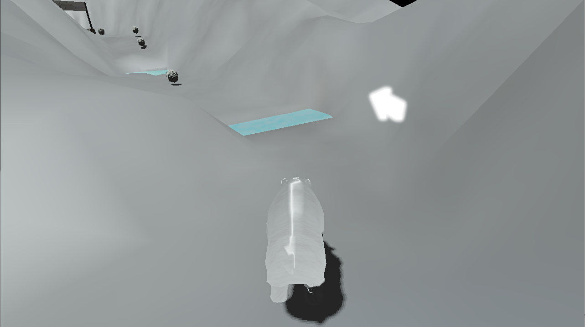

# Bear-In Bear-Out
[](https://github.com/msmiech/bibo/actions/workflows/build.yml)

Bear-In Bear-Out (BIBO) is a simple 3D game in which the objective is to complete a lap as fast as possible and avoiding obstacles



## Features
* The player character is a young brown bear (see [The bear](#the-bear) below)
  * Skeleton with inverse kinematics: procedural walking and bounding with the paws planted on the terrain, the body follows slopes and leans into turns
  * Strand based fur that is generated on the GPU and reacts to movement, wind, the ground, obstacles and hits
  * Detailed face: eyes with iris and pupil that look around and blink with their eyelids, a jaw, tongue and teeth, ears and tail that swing
  * Running into a rock knocks the bear over: it tumbles as a ragdoll until it lies still, then gets up, shakes its fur and runs on
  * Idle animations when it stands still for a while: it sits down and stretches (and sticks its tongue out), or sits down and yawns
  * Jumps in a natural arc: holding the button jumps higher, it can still jump right after running over an edge and a jump pressed shortly before landing happens on landing; in the air the bear keeps its momentum
  * Jump animation: the hind legs push off, the legs tuck in, before landing they reach for the ground and the landing is absorbed (the harder, the deeper)
* Third person camera
  * Orbits around the bear with the mouse or the right stick, the mouse wheel zooms, it goes back behind the running bear on its own
  * Does not go into the terrain or through rocks (sphere cast into the physics world)
  * Unlocked mode (L) = 3d flying camera (WASD and the mouse)
* Movable objects with physics (based on Jolt Physics, originally Nvidia PhysX)
* Texture Mapping (including normal maps)
* Lighting and Materials
* A lap around the track: the finish line only counts after all checkpoints along the track were passed in order
* Keyboard and mouse controls
  * WASD or arrow keys to run (relative to the camera)
  * Mouse to look around, mouse wheel to zoom, middle mouse button to put the camera behind the bear
  * Space bar to jump (hold to jump higher)
  * R to restart
  * ESC for the pause menu
  * F-Keys for settings and debug features (F1 for help)
* Gamepad controls (e.g. Sony DualSense, Xbox Series controller)
  * Left stick to run, right stick to look around (press it to put the camera behind the bear)
  * Cross / A to jump (hold to jump higher)
  * Options / Start for the pause menu, D-pad, Cross / A and Circle / B in the menus
  * Other controllers work if GLFW knows them; newer mappings can be added in a `gamecontrollerdb.txt` ([SDL_GameControllerDB](https://github.com/mdqinc/SDL_GameControllerDB)) in the game folder
* Settings for the camera sensitivity and inverting the camera up/down
* Main menu, pause menu, game over menu (restart the run or back to the main menu) and settings menu (based on RmlUi, usable with mouse, keyboard or gamepad)
  * Graphics settings (VSync, HDR, bloom, shadows, normal mapping, transparency, texture filtering, mipmapping, wireframe)
  * Resolution and window mode (windowed, fullscreen or borderless)
* Supports complex models (Collada scenes and skinned glTF models)
* Multiple light sources
* HDR
* Bloom
* Animations (procedural skeletal animation of the bear, animated objects)
* Transparency
* Shadow Maps
* Animated textures (e.g. water)
* View frustum culling: objects outside of the camera's view are not drawn (F8 to switch it off, the HUD shows how many objects are drawn)

## Building
The game is built with [CMake](https://cmake.org) 3.25 or newer, the [Ninja](https://ninja-build.org) build tool and any C++17 compiler (Clang, GCC, MinGW-w64 or MSVC).
All libraries are downloaded and built automatically the first time the project is configured (about 180 MB, internet access required),
so apart from the tools only the OpenGL and windowing headers of the operating system are needed.
Running the game requires a graphics card with OpenGL 4.3 support.

### Windows
1. **Install the tools (once).** The recommended compiler is [LLVM-MinGW](https://github.com/mstorsjo/llvm-mingw) (Clang/LLVM with the Universal C Runtime of Windows).
   It does not need Visual Studio or the Windows SDK, and the game it builds runs without any extra DLLs.
   In PowerShell:

   ```powershell
   winget install --id Kitware.CMake -e
   winget install --id MartinStorsjo.LLVM-MinGW.UCRT -e
   winget install --id Ninja-build.Ninja -e
   ```

   Without winget, download the `llvm-mingw-<version>-ucrt-x86_64.zip` from the [LLVM-MinGW releases](https://github.com/mstorsjo/llvm-mingw/releases)
   and `ninja-win.zip` from the [Ninja releases](https://github.com/ninja-build/ninja/releases), unpack them and add their folders (for LLVM-MinGW the `bin` folder) to the `Path` environment variable.

2. **Open a new terminal** (changes to `Path` only apply to newly started terminals) and check that all tools are found:

   ```powershell
   cmake --version
   ninja --version
   clang --version
   ```

3. **Configure and build** in the folder of this repository:

   ```powershell
   cmake -S . -B build -G Ninja -DCMAKE_BUILD_TYPE=Release
   cmake --build build --parallel
   ```

   `-G Ninja` is required on Windows: without it CMake looks for Visual Studio or Microsoft's NMake.

4. **Run the game:**

   ```powershell
   cd build
   .\BIBO.exe 1280 720 0
   ```

Alternatively, [MSYS2](https://www.msys2.org) provides GCC: install the packages `mingw-w64-ucrt-x86_64-toolchain mingw-w64-ucrt-x86_64-cmake mingw-w64-ucrt-x86_64-ninja` with `pacman`
and run steps 3 and 4 in the *MSYS2 UCRT64* shell (`./BIBO.exe 1280 720 0`).
Visual Studio 2022 or newer can also open the folder directly as a CMake project.

### Linux
1. **Install the tools and headers (once).** On Debian/Ubuntu:

   ```bash
   sudo apt install build-essential cmake ninja-build git pkg-config libgl-dev libx11-dev libxrandr-dev libxinerama-dev libxcursor-dev libxi-dev libwayland-dev libxkbcommon-dev wayland-protocols
   ```

2. **Configure and build** in the folder of this repository:

   ```bash
   cmake -S . -B build -G Ninja -DCMAKE_BUILD_TYPE=Release
   cmake --build build --parallel
   ```

3. **Run the game:**

   ```bash
   cd build
   ./BIBO 1280 720 0
   ```

To use the libraries of the distribution instead of downloading them, also install `libglfw3-dev libglm-dev libassimp-dev libfreetype-dev libglew-dev` and add `-DBIBO_USE_SYSTEM_LIBS=ON` to the configure command.

### macOS
Not supported: the game requires OpenGL 4.3, macOS only provides OpenGL 4.1.

### Running and distributing
The build copies the game assets (`Font`, `Shader`, `Texture`, `UI`, the scene `Model/SnowTerrain/track1.dae` and the bear `Model/BearCub/BearCub.glb`) next to the executable, and the game loads them from the current folder, so always start it from the build folder.
The game starts in the main menu, ESC opens the pause menu during the game.
The settings menu saves the settings to `settings.cfg` in the current folder (a text file, delete it to reset the settings).
The command line arguments `BIBO [width height [fullscreen]]` override the saved resolution and window mode: width and height of the window in pixels and `1` for fullscreen (default: `800 600 0`).

To create a folder with the executable and all assets that can be copied to another computer:

```bash
cmake --install build --prefix BIBO-dist
```

Ready-to-run packages for Windows and Linux are attached to the [releases](https://github.com/msmiech/bibo/releases).
They are built by the [release workflow](.github/workflows/release.yml) when a version tag is pushed, e.g. for version 2.0:

```bash
git tag 2.0
git push origin 2.0
```

Tags with a suffix such as `2.1-rc1` are published as pre-releases.

For a debug build (OpenGL debug output on the console) configure a separate folder with `-DCMAKE_BUILD_TYPE=Debug`, e.g. `cmake -S . -B build-debug -G Ninja -DCMAKE_BUILD_TYPE=Debug`.

### Troubleshooting
* `Running 'nmake' '-?' failed` or `CMAKE_CXX_COMPILER not set`: CMake did not find Ninja or a compiler.
  Check step 2, then configure again with `-G Ninja` and `--fresh` (a failed configuration is remembered in the `build` folder):
  `cmake --fresh -S . -B build -G Ninja -DCMAKE_BUILD_TYPE=Release`
* To use a specific compiler, add e.g. `-DCMAKE_C_COMPILER=clang -DCMAKE_CXX_COMPILER=clang++` to the configure command (together with `--fresh`).
* `Could not create a window with an OpenGL 4.3 core context`: update the graphics driver; OpenGL 4.3 is required.

## Testing
The automated tests use [Catch2](https://github.com/catchorg/Catch2) and are built together with the game (configure with `-DBIBO_BUILD_TESTS=OFF` to skip them).
Run them in the build folder with CTest:

```bash
ctest --test-dir build --output-on-failure
```

The tests are in the `tests` folder:
* `unit`: game rules (falling off the track, checkpoints in their order, the finish line), physics (gravity, ground, walls, the bear walking, climbing, sliding and jumping, rock collisions, ray casts, sphere casts, ragdolls falling and coming to rest with connected joints), animation (transforms, forward kinematics, two bone IK, springs), the fur (guide hairs lag behind, hang down, lie on the ground and on obstacles, hits ruffle them; strand placement), the view frustum (compared with the camera matrices for random cameras), math helpers, the generated textures and the input (stick dead zones, moving relative to the camera)
* `assets`: the content of the asset files, e.g. every node the game loads exists in the track, the bear starts on the terrain and on the finish line, going backwards from the start does not count, the checkpoints are apart and the collision mesh of the terrain matches the rendered terrain; the bear model (its skeleton matches its skinning, it stands on the ground and fits its capsule, fur and bare skin, eyes, mouth, tongue, teeth and claws) and the bear in action (paws planted while it runs, knocked down by a rock it tumbles, gets up and runs again, rolling over from its back, idle animations and how moving interrupts them, blinking and looking around, steering, jumping higher the longer the button is held, jumping after running over an edge and just before landing, the legs reaching for the ground and landing without jumping paws)
* `gl`: everything that needs an OpenGL 4.3 context: shaders, textures, models and their bounding spheres, the camera (orbiting, following, going back behind the bear, keeping out of obstacles) and the whole scene (e.g. culling never removes a visible pixel, the camera never goes into the terrain of the track). These tests are reported as *skipped* if no context can be created (no display, no OpenGL 4.3).
  On Linux servers without a graphics card they run on a virtual X server with Mesa's software renderer: `xvfb-run -a ctest --test-dir build --output-on-failure`

Every test case is a separate CTest test and its Catch2 tags become CTest labels, e.g. only the physics tests: `ctest --test-dir build -L physics`.
The test executable can also be run directly, e.g. `build/tests/bibo_tests "[rules]"` (see `--help` for the options of Catch2).

The CI also runs the tests with AddressSanitizer and UndefinedBehaviorSanitizer (memory errors, leaks, undefined behavior). On Linux:

```bash
CFLAGS="-fsanitize=address,undefined" CXXFLAGS="-fsanitize=address,undefined" LDFLAGS="-fsanitize=address,undefined" cmake -S . -B build-asan -G Ninja -DCMAKE_BUILD_TYPE=RelWithDebInfo
cmake --build build-asan --parallel
UBSAN_OPTIONS=halt_on_error=1 xvfb-run -a ctest --test-dir build-asan --output-on-failure
```

## Implementation Details
### Language and Compiler
This project was originally written in C++11 using Microsoft Visual Studio 2013.
It now uses C++17 and CMake, and builds with GCC, Clang, MinGW-w64 and MSVC on Windows and Linux.
For hardware graphics (modern) OpenGL 4.3 (core profile) is used.
It was developed for Windows 8.1 and Windows 10 and tested using Nvidia GeForce graphics hardware
### The bear
**Model.** `Model/BearCub/BearCub.glb` is generated by a Blender script, so it can be changed and rebuilt (Blender 4.2 or newer, tested with 5.2):

```bash
blender --background --factory-startup --python tools/build_bear_cub.py
```

The body is a signed distance field of soft-blended primitives (see `PRIMITIVES` in the script) with the mouth carved out of it;
its surface is extracted and remeshed into evenly sized quads. Eyes, eyelids, nose, tongue, teeth and claws are separate meshes.
The skeleton has a spine chain, a head with jaw, tongue, eyes, eyelids and ears, legs with two IK bones each plus a paw, and a tail;
the skin weights come from Blender's automatic weights (the jaw's from its shape). The mouth is modelled open, the game closes it with the jaw.
The vertex colors hold the fur color and the fur length (alpha), the eyes the direction from their center (iris and pupil are drawn by the shader).
The script also saves `Model/BearCub/BearCub.blend` to look at the result, and `--preview <folder>` renders preview images.

**Animation** (`BIBO/Scene/BearRig.cpp`, `BIBO/Animation`): there are no animation clips, the pose is computed every frame.
When walking and bounding, the paws are planted where they land (found with ray casts) and the legs reach them with two bone inverse kinematics;
the body bobs with the steps, follows the ground and leans into turns. Ears and tail are springs, the eyes make saccades and blink with their lids.
The idle animations (stretching, yawning) and getting up are key poses of the body, the paws and the face, also solved with IK.
In a jump the hind paws push off from where they left the ground, the legs tuck in, and when a ray cast finds that the ground is close (by the falling speed)
the legs reach for it; on landing the paws are put down where they are, springs dip the body and the nose and the steps blend in.

**Fur** (`BIBO/Scene/Fur.cpp`, `Shader/bear_fur.*`): every vertex of the skin has a guide hair, a damped spring that lags behind when the body
accelerates, hangs down, moves in the wind, lies on the ground and on rocks and is ruffled by hits (simulated on the CPU).
60000 strands are generated on the GPU from the skinned vertices (no vertex buffer, only the triangle and the position on it per strand):
each strand is a curved, camera facing ribbon that interpolates the guide hairs of its triangle, shaded with Kajiya-Kay highlights.
Further away fewer, wider strands are drawn.

**Ragdoll** (`BIBO/Scene/BearCharacter.cpp`): a hit on a rock starts a Jolt ragdoll (capsules with swing-twist and hinge joints) from the current pose and
velocities. When it lies still, the bear rolls over if it is on its back, pushes itself up, shakes its fur and gets back the control.
### Libraries and Dependencies
Downloaded automatically by CMake (see `CMakeLists.txt` for the exact versions and checksums):
* [Assimp](https://github.com/assimp/assimp) 6.0 (model loading: Collada for the track, glTF for the bear)
* [FreeType](https://freetype.org) 2.14 (text rendering)
* [GLEW](https://github.com/nigels-com/glew) 2.3 (OpenGL function loading)
* [GLFW](https://www.glfw.org) 3.4 (window and input)
* [GLM](https://github.com/g-truc/glm) 1.0 (math)
* [Jolt Physics](https://github.com/jrouwe/JoltPhysics) 5.6 (physics, replaces Nvidia PhysX 3.3.4)
* [RmlUi](https://github.com/mikke89/RmlUi) 6.3 (menus, written in RML and RCSS similar to HTML and CSS, see the `UI` folder)
* [stb_image](https://github.com/nothings/stb) (image loading, replaces DevIL)
* [Catch2](https://github.com/catchorg/Catch2) 3.16 (tests only)

## Sources
### Literature
* "OpenGL SuperBible"
* learnopengl.com
* opengl-tutorial.org
* ogldev.atspace.co.uk
* open.gl
* lighthouse3d.com/tutorials
* learncpp.com
### Assets
* BearCub (the player character): made for this game, generated by [tools/build_bear_cub.py](tools/build_bear_cub.py) (see [The bear](#the-bear))
* BearBrown (the bear of earlier versions, still in the track file but no longer used) - http://tf3dm.com/3d-model/bear-98965.html
* SnowTerrain - http://tf3dm.com/3d-model/snowy-terrain-46334.html
* Rock - http://tf3dm.com/3d-model/rock-86533.html
* Salmon - http://tf3dm.com/3d-model/salmon-44387.html
* Font: [DejaVu Sans](https://dejavu-fonts.github.io) (see `Font/DejaVuSans-LICENSE.txt`)
* The chequered flag of the finish line and the TV static of the monitor are generated by the game
